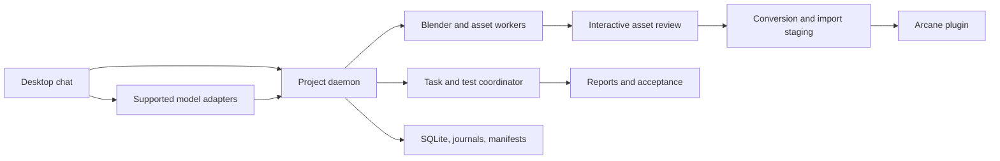

# System map

| Responsibility | Source entry points |
|---|---|
| Desktop and chat | `apps/desktop/src`, `apps/desktop/electron` |
| Project services | `apps/daemon/src` |
| Model transport and continuation | `packages/codex-client/src` and provider adapters |
| Assets | `packages/asset-pipeline/src`, `workers/blender` |
| Plugin | `plugin`, `scripts/build-plugin.mjs` |
| Persistence | `packages/storage/src` |
| Tests and delivery | `tests`, `.github/workflows`, desktop release scripts |

[[Architecture/Chat and Sessions]] · [[Architecture/Asset Pipeline]] · [[Architecture/Task Lifetimes]] · [[Architecture/Plugin and Import]] · [[Architecture/Diagnostics and Services]]
