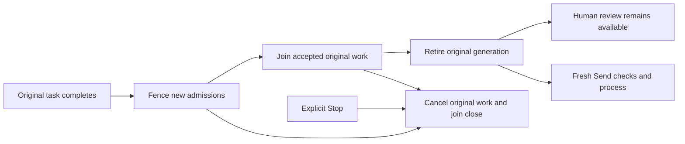

# Task lifetimes

Task status, original request completion, worker closure, resource cleanup and human acceptance are separate facts.

[[Architecture/Native Session Custody]] records original native allocation, possible write capability and physical transport closure across restarts. Normal task retirement cannot settle that journal. Older tasks without closure evidence remain retained; resource-specific worker/import accounting is still required before independent-session recovery.

Register original work before allocation or its first asynchronous effect. Join allocation, publication, persistence and original cleanup tails. Normal retirement fences new work while allowing accepted work to finish; explicit Stop must still cancel the original owned work. Preserve exact first failures, including falsy thrown values, without confusing normal interrupted requests with failed cleanup.

Unknown acknowledgement, worker ownership or physical closure remains retained and must not trigger replay. Genuine completed work can release bookkeeping only under its actual ownership and capacity rules. JSON state or copied IDs cannot reconstruct a live capability. Human review and later Keep/import decisions must remain independently available where supported.

[[Delivery/G04 Task Lifetimes]] · [[Delivery/G07 Test and Repair]] · [[Development Skills/arcane-task-lifetimes/SKILL]]

## Connected handoff · hosted validation pending

[[Bugs/Normal Task Handoff]] implements the following separate lifetimes. Source review is complete; exact hosted and customer acceptance remains outstanding.

The admission fence must not invalidate genuine already-leased actor guards. Only actual original physical close permits transport closure bookkeeping. Retained read-only focus cannot re-enable the old credential; normal retirement does not mark human acceptance or release archival pins.
